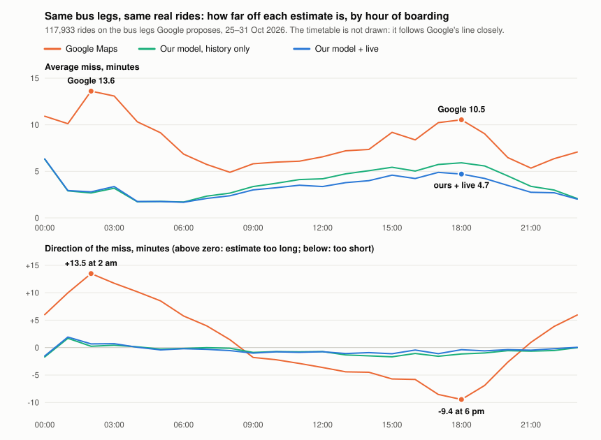

# Proposal

Delhi bus journey planner — Transport Stack Hackathon 2026, Problem 1: real-time bus traffic model and journey planner.

## 1. Summary

Delhi's published bus timetable assumes 18 km/h on every road at every hour. Google Maps' bus times for Delhi behave the same way: one fixed duration per ride, whatever the hour. Real buses average about 31 km/h at 2 am and 13 km/h at 6 pm.

We use the bus fleet's GPS to learn how long buses really take on each stretch of road at each time of day, correct that with the live feed, and plan journeys with those times.

- **It works today.** One program serves a documented API and a map page, with live data.
- **It is measured.** On 112,251 real bus rides in a week the model never saw, our estimate of the ride time missed by 3.3 minutes on average. Google Maps missed by 7.0 on the same rides.
- **It shows its evidence.** Every bus leg reports what its time rests on and whether the bus is tracked.

## 2. The problem

A commuter cannot tell from the timetable whether a trip takes 30 minutes or 60, because the timetable does not know. We measured it: every stop-to-stop hop in the static GTFS is scheduled at 18 km/h, and every trip on a route has the same duration all day.

The brief's own example, Kashmere Gate ISBT to Nehru Place on a Tuesday, as our planner answers it from history:

| Leaving at | Best option | Door to door | Time on buses | Timetable, same buses |
|---|---|---|---|---|
| 08:30 | 425CL, direct | 55 min | 47 min | 48 min |
| 14:00 | 425CL, direct | 72 min | 64 min | 48 min |
| 19:00 | 425, direct | 87 min | 79 min | 50 min |
| 23:00 | 419, then 511A | 62 min | 46 min | 58 min |

The timetable is about right at 08:30, half an hour short at 19:00 and 12 minutes long at 23:00. One number per ride cannot be right at all three.

## 3. What we found in the data

We profiled every dataset before designing anything. The findings that shaped the design:

- **The timetable carries no traffic information.** It is distance divided by 18 km/h. We use it for which buses run and how often, and as the baseline to beat.
- **Google's Delhi bus times are a timetable too.** We asked Google at five times of day. On all 201 bus legs that came up more than once, the duration was the same to within a minute, at a steady 1.06 times the published timetable's.
- **A route in this GTFS is one direction, one path and one stop sequence.** Each GPS point names its route, so linking a bus to the road reduces to "how far along its own route is it".
- **The timetable is right about how much service runs and wrong about when.** On one October day we saw 58,117 bus runs against 65,322 timetabled trips. But 255,475 observed terminal departures were a median 4.3 minutes from the nearest timetabled start, against 5.0 if buses ignored the timetable altogether.
- **The feed needs care.** It refreshes about every 24 seconds and runs about 100 seconds behind. Its speed field is wrong by a factor of about three, its trip id does not match the timetable, and buses parked at depots report all day.

## 4. Approach

Everything rests on one table built from GPS: "a bus went from stop A to the next stop B, starting at time t, and took x seconds". The network has 14,865 such stretches, and October 2026 gave 38.4 million measurements of them.

1. **Link GPS to routes.** Each point is projected onto its own route's path and followed forward along it. This is map matching in one dimension, and it cannot snap a bus to a parallel road. Loops, wrong direction tags and parked buses are handled explicitly.
2. **Estimate the usual time.** `seconds = length × city pace × stretch factor × time-of-day factor`, for four kinds of day. Each factor is trusted in proportion to its data, so a stretch with few buses falls back to its neighbours and then to the city's rhythm.
3. **Correct with live data.** For each stretch, how long buses took in the last hour against the usual. The correction fades with how far ahead the bus will reach the stretch.
4. **Board real buses.** For a trip leaving now, the planner runs each tracked bus forward from its GPS position and offers that bus, not a timetabled one.
5. **Search journeys** over the retimed timetable (RAPTOR, up to three buses, with walking), and return two or three options with the same trip at a quiet hour beside each.

The brief's three questions, in short:

| Question | Our answer |
|---|---|
| GPS is noisy, irregular, late or missing | Points more than 60 m off the route, jumps and long gaps are dropped. About 15% of stop times are rejected for a GPS gap |
| Waiting at stops and signals | Included in the stretch time, because the rider experiences the total. Stretch times then add up exactly to the end-to-end ride |
| Few buses on some roads at some hours | The fallback order above. The answer reports which level each ride rests on |

The technical note gives each step in full.

## 5. What works today

**The prototype.** One Rust program, `busplan`. `busplan serve --collect` records the live feed, serves `GET /journeys`, `GET /stops` and `GET /health`, and a map page that is a client of that API. A journey is answered in under 20 milliseconds. The repository ships the fitted model (8 MB), so it runs without the 116 GB archive.

**Accuracy.** Average miss in time on the bus. The model's settings were chosen on 1–24 October; the week of 25–31 October was looked at only afterwards.

| Test | Rides | Google Maps | Timetable | Our model | Our model + live |
|---|---|---|---|---|---|
| Every bus ride in the unseen week | 509,464 | – | 7.9 min | 4.1 min | 3.4 min |
| The bus legs Google proposes, same week | 112,251 | 7.0 min | 7.0 min | 3.8 min | 3.3 min |
| The same legs on the day Google was asked | 1,032 | 6.5 min | 6.8 min | 5.4 min | 4.1 min |
| 30 origin–destination pairs, four times of day | 108 pair-times | 11.8 min | 12.8 min | 4.7 min | 3.6 min |

Google is nearly 14 minutes too long at 2 am and 9 minutes too short at 6 pm. Ours stays within about a minute of zero lean all day.

**When the bus comes.** For a bus on the road, the predicted arrival at a stop 0 to 5 minutes ahead misses by 0.9 minutes, and 40 to 60 minutes ahead by 4.9. A rider's wait for a tracked bus is missed by 4.6 minutes on average; reading it off the timetable misses by 19.6.

The validation report has the method, the per-pair table and what the tests do not show.

## 6. What is new here

- **Google is scored on its own bus legs.** Each leg Google proposes is matched to the same route and stops in our network, so Google, the timetable and our model are all judged on the same ride against the same real buses. Route choice cannot help or hurt anyone.
- **Live data stays useful for hours.** We started with a 30-minute fade. Replaying the archive showed that a stretch slower than usual now is mostly still slower hours later; the fitted fade is 6 hours, and live data improves trips leaving up to 4 hours ahead.
- **Buses that have not left yet.** A bus standing at its route's first stop becomes the route's next departure, at an estimated time. On a day the rule was not fitted on, this cut the miss in waiting time from 19.6 to 9.2 minutes at the stops it affects.
- **Answers that show their evidence.** Each bus leg says whether it is tracked, standing at its first stop or timetabled, how many buses really passed the stop in the last hour against the timetable's count, and how much of the estimate rests on that stretch's own history.

## 7. Who it is for

- **Riders** get a time that changes with the hour and, for a trip leaving now, a real bus to board.
- **Operators and planners** get the table underneath: measured time on every stretch at every half-hour, which shows where and when buses lose time.
- **Other apps** read the published GTFS. The same measurements could replace its 18 km/h times, which would correct every planner that uses the feed (section 9).

## 8. Limits

- Only time on the bus is validated. Nothing observes a rider door to door, so walking and waiting are not scored.
- Where no tracked bus is approaching a stop, our predicted wait is poor: a 27.6-minute average miss, slightly worse than the timetable's 23.4.
- One month of history. Festival weeks and seasons are not learned. On 13 November, a light day, history alone ran long and live data corrected it only for trips leaving within about four hours.
- The estimate leans about 2% short, a known cost of limiting the weight of single very slow buses.
- Built and run on one Mac. Not yet run on Linux or Windows.

## 9. Plan for Phase 2

None of this is built yet.

1. **A range with each estimate**, from the spread the archive holds for every stretch.
2. **Waiting time without a tracked bus.** Use the frequency a route really ran in the last hour in place of timetabled start times, and test it by the same replay.
3. **More history.** Add months as they are released, learn festival weeks, and test a city-wide factor for days that run light or heavy.
4. **A retimed GTFS.** Write the measured times back as `stop_times.txt` by time of day, so any app that reads the feed gets real travel times.
5. **Metro.** Add the platform's Delhi Metro GTFS to the journey search, the multimodal extension the brief welcomes.
6. **A hosted instance** on Linux, so the API can be used without building it.
