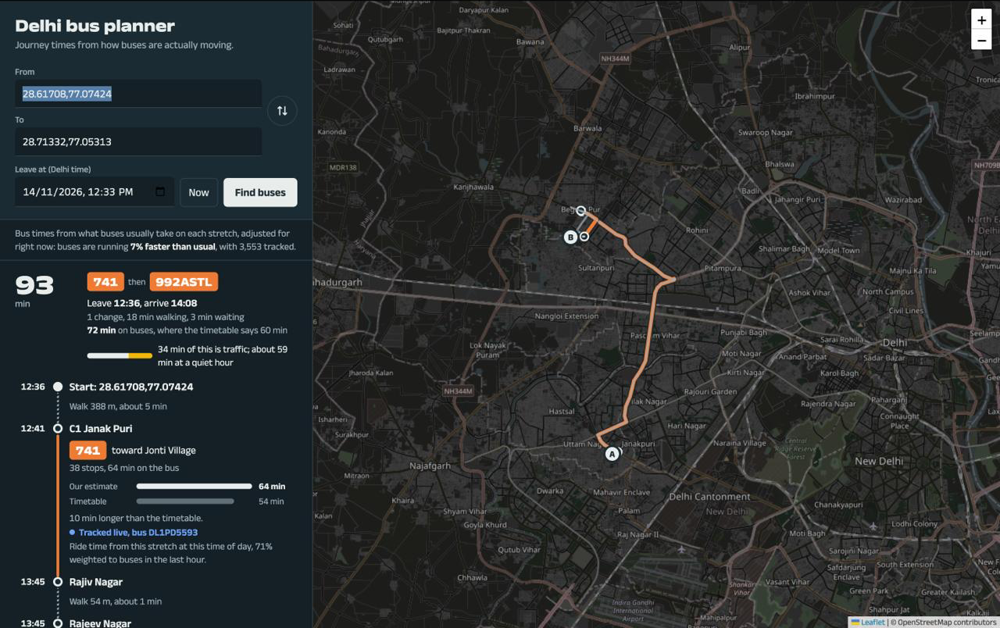

# Delhi bus journey planner

Transport Stack Hackathon 2026, Problem 1: real-time bus traffic model and journey planner.

Delhi's published bus timetable assumes 18 km/h on every road at every hour. This project learns from bus GPS how long buses really take on each stretch of road at each time of day, corrects that with the live feed, and plans bus journeys with those times. It is one program, `busplan`, which serves a JSON API and a map page.

**Try it live: https://d1t0jdf0m74vm2.cloudfront.net** — the map page and the API, running on the live feed.

**Demo video: https://youtu.be/4S2m8QIPsM4**



## What is in this repository

| Deliverable | Where |
|---|---|
| Working prototype, hosted | https://d1t0jdf0m74vm2.cloudfront.net (the API is at the same address: [`/journeys`](https://d1t0jdf0m74vm2.cloudfront.net/journeys?from=Kashmere%20Gate%20ISBT&to=Nehru%20Place), `/stops`, `/health`) |
| Demo video | https://youtu.be/4S2m8QIPsM4 |
| Proposal | [`PROPOSAL.pdf`](PROPOSAL.pdf), or the same text as [`PROPOSAL.md`](PROPOSAL.md) to read here on GitHub |
| Documented API | [API](#api) below |
| Map screen to inspect results | `web/index.html`, served at `http://127.0.0.1:8080/` |
| Technical note | [`TECHNICAL_NOTE.pdf`](TECHNICAL_NOTE.pdf), or the same text as [`TECHNICAL_NOTE.md`](TECHNICAL_NOTE.md) to read here on GitHub |
| Validation report | [`VALIDATION_REPORT.pdf`](VALIDATION_REPORT.pdf), or the same text as [`VALIDATION_REPORT.md`](VALIDATION_REPORT.md) to read here on GitHub |
| Code and run instructions | `src/` and [Run it](#run-it) below |

Accuracy in short (average miss in ride time, from the validation report):

| Test | Google Maps | Timetable | Our model | Our model + live |
|---|---|---|---|---|
| Every bus ride in a week the model never saw (512,270 rides) | – | 7.9 min | 4.1 min | 3.4 min |
| The bus legs Google proposes, same week (117,933 rides) | 7.0 min | 7.0 min | 3.9 min | 3.3 min |
| 30 origin–destination pairs at four times of day | 11.8 min | 12.8 min | 4.7 min | 3.6 min |

## Run it

You need:

- A recent stable Rust (`rustup` installs it; we used 1.100, and the code needs at least 1.85 for the 2024 edition) and a C compiler, because the build compiles SQLite from source.
- The static GTFS zip from delhi.transportstack.in (dataset "Delhi Buses: GTFS Static Data", `delhi_buses_static_gtfs_v1.zip`). Its licence does not allow us to redistribute it, so it is not in this repository. The portal has served two different files under this name; both work ([Which GTFS file](#which-gtfs-file) below).
- For live data, an API key for the realtime feed (dataset "Delhi Buses GTFS-RT").

We built this on macOS (Apple silicon). The hosted copy above is the same code built on Ubuntu 24.04. It has not been run on Windows.

```sh
# 1. Static GTFS: put the zip in this folder, then
mkdir -p data/gtfs && unzip -o -j delhi_buses_static_gtfs_v1.zip -d data/gtfs

# 2. Your realtime key
cp .env.example .env        # then edit .env and set TRANSPORTSTACK_API_KEY

# 3. Build
cargo build --release

# 4. Serve the API and the map page, recording the live feed at the same time
./target/release/busplan serve --collect
```

Open http://127.0.0.1:8080, click the map twice (start, then destination), or type two stop names.

Without a key, leave out `--collect`. The planner then answers from history alone and the page says the live feed is not connected.

### You do not need the October archive

`model/busplan-model.gz` (8 MB) is the fitted travel-time model: what was learned from the organisers' October 2026 archive and our own recording of the live feed in November, 41 million stop-to-stop bus times. The server loads it at start-up in under a second. It holds statistics per stretch of road, not bus positions.

### Which GTFS file

The portal has served two files as `delhi_buses_static_gtfs_v1.zip`:

| | Until mid-November 2026 | Now (downloaded 22 Nov 2026) |
|---|---|---|
| SHA-256 | `b5940afdaf6154880ec5652fd3e8465dd9183b68477c7c71a287685e0ef91ff8` | `8eb05d9c21e7a6b42d7b49de45cb095b70ddee5b8f7716859330c9784c322f05` |
| `feed_version` in `feed_info.txt` | `v1` | `v32` |
| Stops, routes, trips | 6,812, 2,554, 65,322 | 6,862, 2,574, 80,357 |
| Stop-to-stop stretches | 14,865 | 15,119 |

The newer file adds 274 routes, drops 254, and has short-turn trips on 601 routes: 9,314 trips that run only the first part of their route. The program keeps those apart, so a short trip is never offered past the stop where it ends.

The program runs on either file. The shipped model was fitted against the newer one, the one you can download, and has bus times of its own for 14,043 of its 15,119 stretches. The model file is keyed by stop IDs: on the older file, or on any later cut, stretches it does not know fall back to neighbouring stretches or the city-wide pace, and the server says at start-up how many matched.

The validation report's tables are measured on the newer file. Section 8 of the report gives the same tests on the older one: the results are the same.

### What to expect after starting

| Time since start | What works |
|---|---|
| A few seconds | Journeys with historical times for any departure time |
| About 10 seconds | First feed snapshot stored in `data/rt_raw/` |
| 2 to 4 minutes | Buses on the road are tracked; legs start to say "Tracked live" with a number plate |
| 20 minutes | The live correction to travel times starts. It is held back until then because in the first minutes only quick passes have had time to finish, which would make buses look faster than they are |
| 1 hour | The live correction uses its full window (the last hour of bus movements), and legs without a tracked bus show how many buses really passed the stop in the last hour |

`GET /health` shows where it has got to. The recorded feed takes 15 to 20 MB per hour. The map page loads its map tiles and the Leaflet library from the internet.

### Other commands

```sh
./target/release/busplan plan "Kashmere Gate ISBT" "Nehru Place" --depart 2026-11-17T08:30   # one query in the terminal
./target/release/busplan stops "nehru"       # search stop names
./target/release/busplan info                # what was built from the GTFS
./target/release/busplan --help
cargo test --release                         # unit tests
```

If the build fails on macOS with `unknown architecture arm64e.x1-macos`, run it as `SDKROOT=/Library/Developer/CommandLineTools/SDKs/MacOSX.sdk cargo build --release`.

## API

All times are Delhi time (UTC+5:30). The server listens on `127.0.0.1:8080`; change the port with `--port`.

### `GET /journeys`

| Parameter | |
|---|---|
| `from`, `to` | A stop name (`Nehru Place`) or coordinates (`28.5486,77.2513`). Required. |
| `depart` | `YYYY-MM-DDTHH:MM`. Optional; the default is now. |
| `max` | Maximum number of options, 1 to 6. Default 3. |

```sh
curl 'http://127.0.0.1:8080/journeys?from=Kashmere%20Gate%20ISBT&to=Nehru%20Place'
curl 'http://127.0.0.1:8080/journeys?from=28.6692,77.2323&to=28.5486,77.2513&depart=2026-11-17T08:30'
```

Response, shortened (asked on Saturday 14 Nov 2026 at 16:05, with the older GTFS file):

```json
{
  "from": {"name": "ISBT Kashmere Gate", "lat": 28.669372, "lon": 77.227137},
  "to": {"name": "Nehru Place", "lat": 28.547816, "lon": 77.250825},
  "depart": "2026-11-14T16:05:40+05:30",
  "day_type": "saturday",
  "travel_times": "model+live",
  "live": {"as_of": "2026-11-14T16:05:12+05:30", "traversals": 48367, "city_ratio": 0.95, "buses_tracked": 2899},
  "options": [{
    "leave_at": "2026-11-14T16:08:40+05:30",
    "arrive_at": "2026-11-14T17:26:37+05:30",
    "duration_s": 4677,
    "walk_s": 702, "wait_s": 387, "ride_s": 3588,
    "transfers": 1,
    "slack_before_leaving_s": 180,
    "offpeak_duration_s": 2818,
    "traffic_delay_s": 1859,
    "summary": "188DOWN → 425CLUP",
    "legs": [
      {"mode": "walk", "from": {"name": "ISBT Kashmere Gate", "lat": 28.669372, "lon": 77.227137},
       "to": {"name": "ISBT Kashmere Gate (ORR)  / GGS IP University", "lat": 28.669215, "lon": 77.232139, "stop_id": "1072"},
       "distance_m": 636, "duration_s": 509,
       "start": "2026-11-14T16:08:40+05:30", "end": "2026-11-14T16:17:09+05:30"},
      {"mode": "bus", "route": "188DOWN", "route_id": "263", "agency": "DOT",
       "headsign": "Qutubgarh Village   (Terminal) to Kendriya Terminal (Church Road) /  North Block Lane",
       "from": {"name": "ISBT Kashmere Gate (ORR)  / GGS IP University", "lat": 28.669215, "lon": 77.232139, "stop_id": "1072"},
       "to": {"name": "Express Building / Shaheed Park (Bhagat Singh Terminal)", "lat": 28.635077, "lon": 77.241157, "stop_id": "337"},
       "stops": 9, "distance_m": 6626, "wait_s": 0,
       "start": "2026-11-14T16:17:09+05:30", "end": "2026-11-14T16:36:27+05:30",
       "duration_s": 1158, "timetable_s": 1085, "offpeak_s": 572,
       "basis": {"1": 0.78, "2": 0.22}, "live": 0.37, "headway_s": 26700,
       "boarding": "tracked", "vehicle": "DL1PD5275",
       "geometry": [[28.669215, 77.232139], [28.668451, 77.232475], "..."]},
      {"mode": "bus", "route": "425CLUP", "route_id": "3666", "agency": "DTC",
       "headsign": "Kashmere Gate City Bus Terminal to Hamdard Nagar / Sangam Vihar",
       "from": {"name": "Express Building / Shaheed Park (Bhagat Singh Terminal)", "...": "..."},
       "to": {"name": "Nehru Place", "lat": 28.548576, "lon": 77.249133, "stop_id": "2559"},
       "stops": 20, "distance_m": 10782, "wait_s": 387,
       "start": "2026-11-14T16:42:54+05:30", "end": "2026-11-14T17:23:24+05:30",
       "duration_s": 2430, "timetable_s": 2104, "offpeak_s": 1157,
       "basis": {"1": 0.8, "2": 0.1, "5": 0.1}, "live": 0.41, "headway_s": 1440,
       "boarding": "timetable",
       "service": {"seen_last_hour": 0, "timetabled_last_hour": 3, "at_first_stop": 0},
       "geometry": ["..."]},
      {"mode": "walk", "...": "..."}
    ]
  }]
}
```

Top level:

| Field | Meaning |
|---|---|
| `from`, `to` | The places as understood: name, `lat`, `lon` |
| `depart` | The departure time the answer is for |
| `day_type` | `weekday`, `saturday`, `sunday` or `holiday`; each has its own time-of-day profile |
| `travel_times` | Where bus times came from: `model`, `model+live`, `timetable` or `timetable+live` |
| `live` | Present when live data was used (departures from 15 minutes ago to 4 hours ahead): `as_of`, `traversals` (stop-to-stop bus movements seen in the last hour), `city_ratio` (1.2 means buses are taking 20% longer than usual right now), `buses_tracked` |
| `options` | Journeys, shortest door-to-door time first (ties: the earlier arrival, then fewer changes). Which journeys are offered is decided on arrival time, counting five minutes for each change of bus. Empty with a `note` when none was found |

Each option:

| Field | Meaning |
|---|---|
| `leave_at`, `arrive_at` | When to leave to catch the first bus without waiting, and when you arrive |
| `duration_s` | Door to door, from `leave_at` |
| `walk_s`, `wait_s`, `ride_s` | The parts of `duration_s` |
| `transfers` | Changes of bus |
| `slack_before_leaving_s` | Time between the requested departure and `leave_at` |
| `offpeak_duration_s`, `traffic_delay_s` | The same journey at the quietest hour, and how much longer it is now |
| `summary` | The routes, in order |
| `legs` | Walk and bus legs, in order |

Each bus leg (`"mode": "bus"`):

| Field | Meaning |
|---|---|
| `route`, `route_id`, `headsign`, `agency` | The route. `UP` and `DOWN` in the name are its two directions |
| `from`, `to` | Boarding and alighting stops, with `stop_id` |
| `stops`, `distance_m` | Stops ridden past, including the last; distance along the road |
| `wait_s` | Time at the stop before the bus comes |
| `start`, `end`, `duration_s` | Boarding time, alighting time, ride time |
| `timetable_s` | What the published timetable says for the same ride |
| `offpeak_s` | The same ride at the quietest hour |
| `basis` | What the estimate rests on, as the share of the ride's stretches at each level: `1` this stretch at this time on this kind of day, `2` this stretch at this time on any day, `4` this stretch at any time, `5` neighbouring stretches, `6` the city-wide pattern, `7` the timetable. Low numbers mean more direct evidence |
| `live` | How much of the estimate rests on buses seen in the last hour, 0 to 1 |
| `boarding` | Where the boarding time comes from: `tracked` (a real bus on its way, run forward from its GPS position), `at_first_stop` (a real bus standing at the route's first stop, with an estimated departure) or `timetable` (a timetabled start; read the time as approximate) |
| `vehicle` | The bus's number plate, for `tracked` and `at_first_stop` |
| `service` | For legs that are not `tracked`, what the route was really seen to run: `seen_last_hour` (buses that passed the boarding stop), `timetabled_last_hour`, and `at_first_stop` (buses standing at the route's first stop now) |
| `headway_s` | The timetabled gap between buses on this route around boarding time |
| `geometry` | `[lat, lon]` points along the road |

A walk leg has `from`, `to`, `distance_m`, `duration_s`, `start` and `end`.

Errors are HTTP 400 with `{"error": "..."}`: an unknown place, a missing parameter, or a time that cannot be read.

### `GET /stops?q=<text>&limit=<n>`

Stop names matching the text, for autocomplete.

```json
[{"name": "Nehru Place", "lat": 28.548576, "lon": 77.249133, "routes": 76},
 {"name": "Nehru Place Terminal", "lat": 28.548700, "lon": 77.256981, "routes": 84}]
```

### `GET /health`

```json
{
  "status": "ok",
  "network": "6812 stops, 2554 routes, 65322 trips, 14865 segments, 23140 walking links",
  "travel_times": "model",
  "basis": "39943322 observed segment traversals, 2026-09-30T23:59:18+05:30 to 2026-11-14T15:44:34+05:30, covering 13607 of 14865 segments (saved model model/busplan-model.gz)",
  "live": {"as_of": "2026-11-14T16:05:12+05:30", "traversals_last_hour": 48367, "segments_with_live_data": 12338, "city_ratio": 0.946, "buses_tracked": 2899},
  "feed_archive": {"collecting": true, "last_snapshot_age_s": 21}
}
```

`live` is `null` until the feed has been recorded for a few minutes. `feed_archive.collecting` is true when a snapshot arrived in the last two minutes. This example was recorded on the older GTFS file; on the current one `network` reads `6862 stops, 2574 routes, 80357 trips (9314 of them short-turn trips, on 601 routes), 15119 segments, 23418 walking links`.

### `GET /`

The map page. It is a client of the three endpoints above.

## Rebuilding the model from the archive

Only needed to check that the shipped model is what the code produces.

```sh
# The organisers' archive: one SQLite file per day, bus_movements_YYYY_MM_DD.db (116 GB unpacked for October 2026)
mkdir -p data/hist/2026-10 && tar -xf delhi-dtc-bus-gtfs-rt-2026-10.7z -C data/hist/2026-10

./target/release/busplan import data/hist/2026-10    # GPS -> stop-to-stop times in data/traversals/, about 17 s per day
./target/release/busplan extract                     # the same for the feed you recorded with --collect
./target/release/busplan model                       # fit, and print city speed by hour
./target/release/busplan save-model                  # write model/busplan-model.gz and read it back to check
```

When `data/traversals/` exists, `busplan serve` fits on it at start-up (about 2 seconds for October) and uses the result if it rests on at least as many bus times as the saved model.

## Checking the accuracy numbers

Section 7 of the validation report lists the command behind each table. The report's numbers are for the current GTFS file; on the older one the ride counts come out a little lower and the errors the same (report, section 8). What each one needs:

| Command | Reproduces | Needs |
|---|---|---|
| `busplan eval --test-from 2026-10-25T00:00 --test-until 2026-11-01T00:00` | Test A: every ride in an unseen week | The October archive, imported |
| `busplan tune --set final` | The cross-validation that chose the model's settings | The same |
| `busplan validate` | Tests B, C and D against Google Maps | The same, plus Google's answers in `data/google/` |
| `busplan nextbus --test-from 2026-11-13T11:50 --test-until 2026-11-13T17:40` | When the bus comes (report section 4) | A feed recorded with `--collect` over the hours to be replayed, then `busplan extract` |

Google's answers and our own recording of the feed are not in this repository: Google's terms and the Transport Stack licence do not allow redistributing them. `busplan google --when <time>` fetches Google's answers again with your own key (`GOOGLE_MAPS_API_KEY` in `.env`, Routes API enabled). It stops itself at 2,000 calls a month to stay inside Google's free allowance.

## Layout

```
src/
  gtfs.rs      static GTFS -> stops, routes, stop-to-stop stretches, walking links
  geom.rs      geometry: local metric plane, projection onto a route's path
  rt.rs        reader for GTFS-Realtime snapshots
  collect.rs   records the live feed while the server runs
  link.rs      GPS points -> position along the route -> time at each stop -> stretch times
  model.rs     the historical travel-time model, and saving and loading it
  live.rs      the live correction, and what each route was really seen to run
  raptor.rs    the retimed timetable (with tracked buses) and the journey search
  planner.rs   query -> journey options (the API response)
  api.rs       HTTP routes;   main.rs  command line
  eval.rs, nextbus.rs, validate.rs, compare.rs, google.rs   the tests behind the validation report
web/index.html                        the map page (compiled into the program)
model/busplan-model.gz                the fitted model
validation/                           the 30 origin-destination pairs and the hubs they were built from
scripts/make_validation_charts.py     draws the report's two charts
img/                                  the screenshot above and the report's two charts
PROPOSAL, TECHNICAL_NOTE, VALIDATION_REPORT   the three documents, each as .pdf and as .md (same text)
```

## Data and attribution

Bus data: Delhi Transport Stack (delhi.transportstack.in), used under its data licence. The static GTFS and raw bus positions are not redistributed here; the model file is a derived work. Map tiles: OpenStreetMap contributors. Map display: Leaflet.
