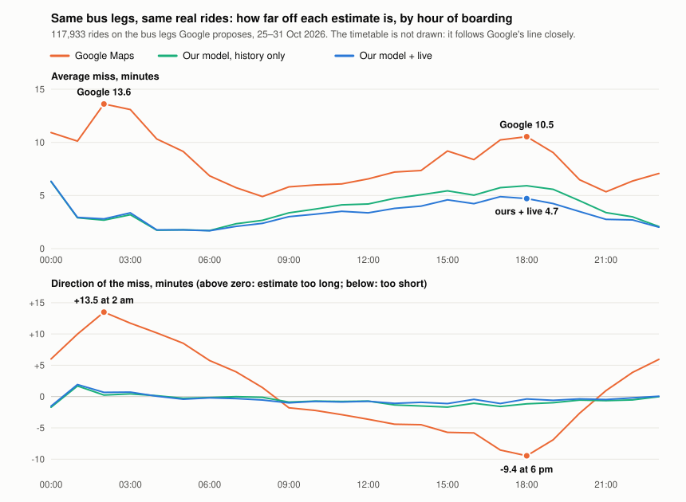
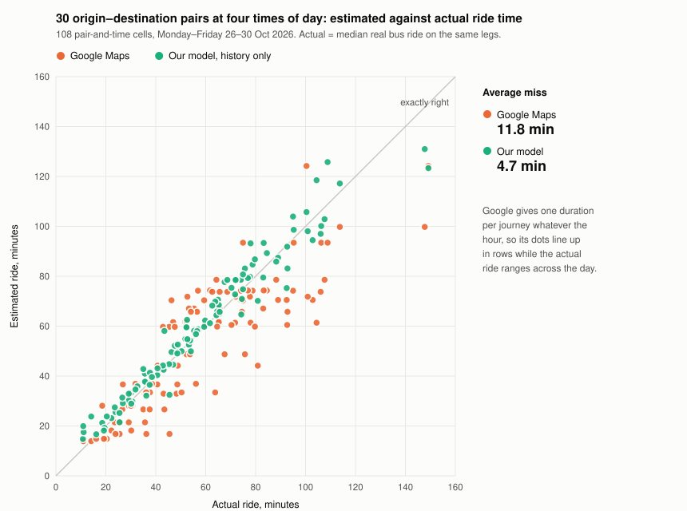

# Validation report

Delhi bus journey planner — Transport Stack Hackathon 2026, Problem 1.

## 1. Summary

We checked our travel-time estimates against what buses really did, and against Google Maps, in four ways. On the two large tests that include Google (B and D) our miss is under half of Google's; on the smaller same-day test (C) it is a little over half.

| Test | Rides checked | Google Maps | Timetable | Our model | Our model + live |
|---|---|---|---|---|---|
| A. Every bus ride in a week the model never saw | 512,270 | – | 7.9 min (26.9%) | 4.1 min (13.8%) | 3.4 min (12.0%) |
| B. The bus legs Google proposes, same week | 117,933 | 7.0 min (29.9%) | 7.0 min (28.6%) | 3.9 min (16.2%) | 3.3 min (13.8%) |
| C. The same legs on the days Google was asked (13 and 14 Nov) | 2,722 | 6.3 min (26.3%) | 6.2 min (25.1%) | 4.6 min (19.4%) | 3.6 min (14.6%) |
| D. 30 origin–destination pairs at four times of day | 108 pair-times | 11.8 min (20.5%) | 12.8 min (21.9%) | 4.7 min (9.6%) | 3.6 min (7.3%) |

Each cell is the average miss in minutes (mean absolute error), with the average percentage miss in brackets. Actual ride times are set beside each estimate in section 3.

- **"Our model"** uses history only: what we would say for a trip days ahead.
- **"Our model + live"** corrects that history with the live GPS feed: what we say for a trip leaving now. For every stretch of road it measures how much slower or faster buses are running right now than they usually do at this hour. It trusts that reading in proportion to how many buses just passed and how recently, fills gaps from neighbouring stretches and from the city as a whole, and applies the correction to each stretch of the ride according to when the bus will reach it (technical note, section 3).
- **"Timetable"** is the published schedule, which assumes 18 km/h on every stretch at every hour.

Google's bus times for Delhi turn out to be a timetable too. We asked Google at nine times over two days, between 9 am and 10:30 pm. On all 635 bus legs that came up at more than one of those times, Google gave the same duration to within a minute, and that duration is a steady 1.06 times the published timetable's. That is why Google and the timetable score alike.

## 2. What "actual" means, and how the tests were kept honest

- **Actual ride time** is measured from bus GPS: the time one bus took from one stop to a later stop on its route (technical note, sections 1–2). It is time on the bus. Walking and waiting are not observed by anything we have, so they are not scored here.
- **The data** is the organisers' October 2026 archive (38.6 million stop-to-stop times) plus our own recording of the live feed on 13 and 14 November.
- **The timetable file** is the static GTFS the portal serves now. Section 8 gives the same tests on the file it served until mid-November.
- **Train on the past, test on the future.** Model settings were chosen on 1–24 October by cross-validation. The week of 25–31 October was looked at only after the settings were fixed. The model scored on it was fitted on 1–24 October only.
- **Live data is replayed, not peeked at.** For each test ride the live view contains only bus movements that had finished at least 100 seconds before the ride began (the feed's own delay).
- **Same legs for everyone.** In tests B, C and D every estimate is for the same route between the same two stops, so differences in route choice cannot help or hurt anyone.

## 3. Results

### 3.1 Test A — every ride in an unseen week

All bus rides of 5 or more consecutive stops on 25–31 October: 512,270 rides, averaging 30 minutes.

| | Average ride | Average miss | Percentage miss | Half of rides within | 9 in 10 within |
|---|---|---|---|---|---|
| **Actual** | **30.2 min** | | | | |
| Timetable says | 27.6 min | 7.9 min | 26.9% | 5.0 min | 18.3 min |
| Our model says | 29.3 min | 4.1 min | 13.8% | 2.3 min | 9.7 min |
| Our model + live says | 29.6 min | 3.4 min | 12.0% | 2.0 min | 8.0 min |

By ride length, model against timetable: rides of 5–14 stops (average 17 min) 2.9 against 5.4 min; rides of 15 or more stops (average 48 min) 5.7 against 11.4 min.

By time of day the timetable is wrong in both directions and the model follows the day:

| Rides starting at | 02:00 | 06:00 | 08:00 | 12:00 | 15:00 | 18:00 | 21:00 |
|---|---|---|---|---|---|---|---|
| Timetable, average miss (min) | 14.7 | 7.5 | 5.3 | 7.0 | 9.0 | 12.3 | 6.2 |
| Our model, average miss (min) | 2.4 | 2.2 | 3.0 | 4.0 | 5.1 | 5.9 | 3.6 |

By day, to show that no single day carries the result:

| Day | Timetable | Our model | Our model + live |
|---|---|---|---|
| Sun 25 Oct | 7.6 | 3.9 | 3.3 |
| Mon 26 Oct | 7.3 | 3.9 | 3.2 |
| Tue 27 Oct | 7.9 | 3.6 | 3.3 |
| Wed 28 Oct | 7.8 | 3.6 | 3.3 |
| Thu 29 Oct | 6.9 | 4.7 | 3.4 |
| Fri 30 Oct | 8.0 | 3.9 | 3.5 |
| Sat 31 Oct | 9.5 | 4.8 | 3.9 |

Thursday 29th ran lighter than a normal weekday and Saturday 31st slower than a normal Saturday. History alone cannot know that; live data brings both back into line.

How long live data stays useful, same week:

| Trip leaves | Now | In 30 min | In 1 hour | In 2 hours | In 4 hours | History only |
|---|---|---|---|---|---|---|
| Average miss (min) | 3.4 | 3.6 | 3.7 | 3.8 | 3.9 | 4.05 |

### 3.2 Test B — against Google Maps, on Google's own bus legs

We asked Google's Routes API for bus journeys between our 30 pairs at nine times on 13 and 14 November. Its answers contain 2,968 bus legs: a line, a boarding stop and an alighting stop. We matched 2,192 of them (74%) to the same route and stops in our network, to within 250 m (median 40 m). That gives 820 distinct legs.

Google cannot be asked about a past date. But its duration for a leg does not depend on when you ask (section 1), so we scored the duration Google gave against every real ride of that leg in the unseen week: 117,933 rides on 751 legs, averaging 25 minutes.

| | Average ride | Average miss | Percentage miss | Half of rides within | 9 in 10 within |
|---|---|---|---|---|---|
| **Actual** | **25.0 min** | | | | |
| Google Maps says | 23.4 min | 7.0 min | 29.9% | 4.4 min | 16.3 min |
| Timetable says | 22.1 min | 7.0 min | 28.6% | 4.2 min | 16.6 min |
| Our model says | 24.3 min | 3.9 min | 16.2% | 2.1 min | 8.9 min |
| Our model + live says | 24.4 min | 3.3 min | 13.8% | 1.8 min | 7.3 min |

The same rides by hour of boarding, in minutes:

| Boarding at | 02:00 | 06:00 | 08:00 | 12:00 | 15:00 | 18:00 | 21:00 |
|---|---|---|---|---|---|---|---|
| Rides | 220 | 5,805 | 10,956 | 5,948 | 4,139 | 5,558 | 4,603 |
| **Actual ride, average** | **20.0** | **16.4** | **22.8** | **24.9** | **31.5** | **31.1** | **21.7** |
| Google Maps says | 33.5 | 22.2 | 24.3 | 21.3 | 25.8 | 21.6 | 22.7 |
| Our model says | 20.2 | 16.3 | 22.7 | 24.2 | 29.8 | 29.9 | 21.1 |
| Our model + live says | 20.6 | 16.2 | 22.3 | 24.2 | 30.3 | 30.7 | 21.2 |

Different legs are ridden at different hours, so Google's average moves a little between columns even though its figure for any one leg never changes.



Google is 13.5 minutes too long at 2 am, about right at 8 am, and 9.5 minutes too short at 6 pm. One fixed number per leg cannot be right at all three. Our estimate with live data stays within about a minute of zero lean from 5 am to midnight (before 5 am, when rides are few, it leans by up to 2 minutes). Its average miss rises from under 2 minutes at dawn to about 5 in the evening peak, when buses themselves are least regular.

### 3.3 Test C — the same legs on the days Google was asked

This is the strict version: Google's answer and the real buses are from the same day and hour. For each time Google was asked, the model was fitted only on data from before that moment and scored on buses that boarded in the following 90 minutes.

| Asked at | Legs | Rides | Actual ride | Google Maps says | Timetable says | Our model says | Our model + live says |
|---|---|---|---|---|---|---|---|
| Fri 13 Nov, 12:24 | 139 | 357 | **26.5** | 25.4 (miss 5.3) | 23.9 (miss 5.6) | 29.0 (miss 4.7) | 26.0 (miss 3.2) |
| Fri 13 Nov, 13:00 | 119 | 257 | **26.4** | 26.0 (miss 5.4) | 24.4 (miss 5.4) | 29.6 (miss 4.2) | 27.1 (miss 2.9) |
| Fri 13 Nov, 18:00 | 150 | 429 | **30.4** | 24.1 (miss 8.0) | 22.8 (miss 8.6) | 35.0 (miss 6.4) | 33.7 (miss 5.4) |
| Fri 13 Nov, 22:30 | 75 | 128 | **16.8** | 23.8 (miss 7.5) | 22.4 (miss 6.2) | 19.1 (miss 2.9) | 17.9 (miss 2.1) |
| Sat 14 Nov, 09:00 | 162 | 719 | **23.7** | 26.7 (miss 5.5) | 25.2 (miss 4.9) | 24.2 (miss 2.5) | 23.3 (miss 2.3) |
| Sat 14 Nov, 13:00 | 115 | 277 | **26.8** | 24.9 (miss 6.5) | 23.4 (miss 6.3) | 28.9 (miss 4.9) | 26.2 (miss 3.4) |
| Sat 14 Nov, 18:00 | 141 | 437 | **31.3** | 27.4 (miss 6.4) | 26.0 (miss 6.9) | 36.5 (miss 7.1) | 34.2 (miss 5.2) |
| Sat 14 Nov, 22:30 | 75 | 118 | **16.9** | 23.7 (miss 7.2) | 22.4 (miss 6.0) | 20.5 (miss 4.1) | 18.9 (miss 3.1) |
| All | 976 | 2,722 | **26.3** | 25.7 (miss 6.3) | 24.3 (miss 6.2) | 29.1 (miss 4.6) | 27.3 (miss 3.6) |

Minutes: the average ride, then the average miss per ride. As a percentage the misses over all eight times are 26.3% for Google, 25.1% for the timetable, 19.4% for our model and 14.6% with live data. The 09:00 answers of 13 November could not be scored because our recording started at 11:43 that day.

Both days ran lighter than October, probably because 13 November falls in the week after Diwali and the 14th is the Saturday of that week. So history alone leaned long, saying 29.1 minutes where buses took 26.3. It still missed by less than Google per ride at seven of the eight times; at 18:00 on the 14th it missed by more (7.1 against 6.4). The live correction brought the average to 27.3 and the miss below Google's at every time. This is the case live data exists for. On both evenings the correction was only partial: buses stayed far faster than a normal evening peak.

### 3.4 Test D — 30 origin–destination pairs at four times of day

For each pair we took one all-bus journey that Google proposed and added up the ride time over its legs. "Actual" is the median real ride on those legs, Monday to Friday 26–30 October, in each of four two-hour windows. Google's figure is the same in every window because Google gives the same figure at every hour.



All times in minutes. "Ours" is the model on history only.

| # | From → to | Google's buses | km | Google | 08–10 actual / ours | 12–14 actual / ours | 17–19 actual / ours | 21–23 actual / ours |
|---|---|---|---|---|---|---|---|---|
| 01 | ISBT Kashmere Gate → Nehru Place | 729↑ → 440A↑ | 20 | 61 | 72 / 73 | 78 / 93 | 104 / 118 | 65 / 71 |
| 02 | Shahdara Terminal → Dhaula Kuan | 623↑ → 740EXT↑ | 23 | 74 | 74 / 79 | 79 / 85 | 95 / 104 | 57 / 59 |
| 03 | Old Delhi Railway Station (T) → Badarpur Village | 405↑ | 19 | 67 | 55 / 58 | 66 / 65 | 83 / 80 | 53 / 52 |
| 04 | Saket Crossing → Lajpat Nagar Crossing | 427↓ | 10 | 33 | 43 / 43 | 36 / 41 | 48 / 50 | 30 / 30 |
| 05 | Mangol Pur Khurd → Seelampur Metro Station | 972↑ → 236↓ | 21 | 70 | 92 / 75 | 89 / 87 | 103 / 94 | – |
| 06 | Badarpur Village → Shivaji Stadium Terminal | 405↓ → 966↑ | 19 | 62 | 52 / 55 | 52 / 60 | 65 / 68 | 47 / 45 |
| 07 | Azadpur Terminal → Nizamuddin Railway Station | 901↓ → 429↑ | 18 | 60 | 59 / 63 | 72 / 76 | 88 / 93 | – |
| 08 | Kapashera Border → Hauz Khas | 706↓ → 764↑ → 507↑ | 18 | 60 | 65 / 66 | – | 80 / 87 | – |
| 09 | Wazirpur Depot → Bawana Dispensary | 141↑ → 919↓ | 19 | 66 | 57 / 58 | 74 / 71 | 93 / 83 | 54 / 50 |
| 10 | Okhla Phase 1 → Dhaula Kuan | 774↑ → 706A↓ | 20 | 70 | 59 / 60 | 74 / 65 | 75 / 75 | 46 / 50 |
| 11 | Mehrauli Terminal → Lajpat Nagar Crossing | 502↓ → D-046↓ → 433↑ | 10 | 33 | 38 / 41 | 50 / 50 | 64 / 70 | 36 / 38 |
| 12 | Dhaula Kuan → Shivaji Stadium Terminal | AIRPORT-EXP-04↓ | 9 | 28 | 31 / 30 | 29 / 30 | 30 / 33 | 19 / 21 |
| 13 | Nehru Place → Nizamuddin Railway Station | D-044↓ | 6 | 18 | 22 / 23 | 30 / 29 | – | – |
| 14 | Nizamuddin Railway Station → Azadpur Terminal | 964↑ | 18 | 60 | 45 / 45 | 48 / 52 | 53 / 63 | 43 / 44 |
| 15 | Inderlok Metro Station → Karol Bagh Terminal | 39↓ | 5 | 17 | 26 / 21 | 46 / 32 | 36 / 32 | 24 / 26 |
| 16 | ISBT Kashmere Gate → Seelampur Metro Station | 982↓ | 6 | 14 | 11 / 15 | 11 / 18 | 14 / 24 | 11 / 20 |
| 17 | Jahangirpuri Metro Station GT Road → Karol Bagh Terminal | 120↓ → 218↑ | 15 | 49 | 52 / 60 | 76 / 83 | 68 / 78 | 54 / 54 |
| 18 | Old Delhi Railway Station (T) → Bawana Dispensary | 116↑ | 29 | 100 | 114 / 117 | 148 / 130 | – | – |
| 19 | ISBT Anand Vihar → Dhaula Kuan | 740EXT↑ | 22 | 72 | 72 / 79 | 78 / 80 | 101 / 98 | 53 / 55 |
| 20 | C1 Janak Puri → Nehru Place | 724↑ → 543A↓ → 440A↑ | 23 | 74 | 77 / 79 | 85 / 89 | 83 / 93 | 62 / 61 |
| 21 | ITO AGCR / ITO → Karol Bagh Terminal | 352↓ | 7 | 21 | 24 / 27 | 29 / 33 | 36 / 38 | 25 / 25 |
| 22 | Okhla Phase 1 → Hauz Khas | 511A↑ → 548↓ | 11 | 37 | 33 / 36 | 41 / 40 | 49 / 49 | 27 / 29 |
| 23 | Peera Garhi Chowk → Bawana Dispensary | 879A↑ → 106↑ | 23 | 79 | 72 / 78 | 88 / 86 | 108 / 103 | 64 / 64 |
| 24 | New Delhi Railway Station Gate 2 → Nehru Place | 445A↑ | 13 | 44 | 41 / 43 | 49 / 52 | 81 / 70 | – |
| 25 | Lajpat Nagar Crossing → Azadpur Terminal | 429↓ → 139↑ | 23 | 74 | 66 / 66 | 69 / 79 | 106 / 97 | 63 / 68 |
| 26 | Shivaji Stadium Terminal → Inderlok Metro Station | 352↓ | 9 | 27 | 27 / 31 | 35 / 43 | 43 / 58 | 38 / 36 |
| 27 | Tilak Nagar Terminal → Punjabi Bagh Terminal | 861A↑ | 5 | 15 | 16 / 17 | 20 / 19 | 20 / 24 | 19 / 18 |
| 28 | Hauz Khas → Okhla Phase 1 | 344↓ → 511A↓ | 12 | 37 | 38 / 40 | – | 56 / 57 | 32 / 35 |
| 29 | Old Delhi Railway Station (T) → Kapashera Border | 729↑ | 30 | 93 | 106 / 100 | 95 / 99 | 109 / 126 | 75 / 81 |
| 30 | Narela Terminal → Uttam Nagar Terminal | 109↓ → 254A↑ → 761↓ | 38 | 124 | 100 / 106 | – | 149 / 123 | – |

↑ and ↓ are the route's two directions. A dash means fewer than 3 real rides on some leg in that window.

Reading one row: for Old Delhi Railway Station to Badarpur, Google proposes the 405 from Red Fort. That ride really takes 55 minutes in the morning, 66 at midday, 83 in the evening and 53 at night. We say 58, 65, 80 and 52. Google says 67 every time. These are times on the bus; Google's door-to-door total for the trip, with the walking, is 82 minutes.

Over the 108 filled cells the average miss is 11.8 minutes for Google, 4.7 for our model and 3.6 with live data.

Where we are worst: pair 16 (a 6 km hop that buses cover in 11–14 minutes; we say 15–24) and pair 26 in the evening (58 against 43). We have not yet traced these.

## 4. When the bus comes

For someone leaving now, the planner also predicts when each bus on the road will reach each stop ahead of it. We replayed 13 November from 12:00 to 17:10, every ten minutes, using only what had been received by each moment, and compared with when those buses arrived: 537,263 predictions.

| Arrival predicted | 0–5 min ahead | 5–10 | 10–20 | 20–40 | 40–60 |
|---|---|---|---|---|---|
| Bus position + our model + live, average miss (min) | 0.9 | 1.5 | 2.2 | 3.3 | 4.9 |
| Bus position + timetable speed, average miss (min) | 1.4 | 2.6 | 3.8 | 5.7 | 8.0 |

A rider's wait for the next bus on a route, when a tracked bus is on its way (415,600 cases): our prediction misses by 4.8 minutes on average and by 1.5 minutes in the typical case. Reading the wait off the timetable misses by 18.6 and 10.5.

## 5. What these tests do not show

- **Walking and waiting are not validated.** Nothing observes a rider door to door. Only time on the bus is scored. Where no tracked bus is approaching a stop, our predicted wait is poor (24.9 minutes average miss, worse than the timetable's 21.9); we know why and have not fixed it yet.
- **Test B applies November answers to October rides.** It rests on Google's durations not changing with time, which held on 635 of 635 legs asked at more than one of nine times over two days. Test C is the check that needs no such assumption; it is smaller (2,722 rides, two days).
- **26% of Google's bus legs could not be matched** to our network (a line we do not have, or stops more than 250 m from ours) and are left out.
- **Our estimate leans about 2% short.** One slow bus may count as at most three times the usual, which protects each stretch from freak values and also trims some real jams. Removing the limit removes the lean and makes the typical miss worse, so we kept it.
- **One month of history.** Festival weeks and seasons are not learned. On 13 and 14 November history alone leaned long; live data corrects that for trips leaving within about four hours, and nothing corrects it for trips days ahead.
- **31% of predicted bus arrivals could not be checked** in section 4, because the bus was not reliably timed at that stop afterwards. For most of those the bus was not seen again on that route; we have not established why.

## 6. Why Google's times behave this way

Google's Delhi bus times come from a published schedule, not from vehicle positions. Evidence from our own queries: the same leg has the same duration at every time asked (635 of 635); answers for 9 am asked again three and a half hours later were unchanged; and for the same leg Google's duration is a tight 1.06 times the open timetable's, which assumes 18 km/h everywhere. Delhi's buses really average about 31 km/h at 2 am and 13 km/h at 6 pm.

## 7. Reproducing these numbers

```sh
./target/release/busplan import data/hist/2026-10        # archive -> stop-to-stop times
./target/release/busplan extract                         # our own recording -> the same
./target/release/busplan eval --test-from 2026-10-25T00:00 --test-until 2026-11-01T00:00   # test A
./target/release/busplan tune --set live --folds 2026-10-25:2026-11-01 --data-until 2026-11-01 --ahead-min 60   # live, leaving later
./target/release/busplan google --when 2026-11-13T13:00  # ask Google (needs a key)
./target/release/busplan validate                        # tests B, C, D
./target/release/busplan nextbus --test-from 2026-11-13T11:50 --test-until 2026-11-13T17:40   # section 4
python3 -I scripts/make_validation_charts.py data/google/validation img   # the two charts
```

## 8. The older timetable file

Until mid-November 2026 the portal served an older static GTFS file under the same name, and our first tests were run on it. The file it serves now adds 274 routes and drops 254, has 80,357 trips where the older one has 65,322, and gives 601 routes short-turn trips, which run only the first part of the route. October's buses ran on routes both files have: on the five days we checked, 99.89 to 99.99% of GPS records were on such routes and none were on routes only the newer file has. In a sample of 14 November, 2.4% of bus positions were on routes only the newer file has.

The same GPS records matched to each file, the same tests, nothing re-tuned. Average miss in minutes:

| Test | GTFS file | Rides | Google Maps | Timetable | Our model | Our model + live |
|---|---|---|---|---|---|---|
| A. Every ride in the unseen week | older | 509,464 | – | 7.9 | 4.1 | 3.4 |
| | current | 512,270 | – | 7.9 | 4.1 | 3.4 |
| B. The bus legs Google proposes, same week | older | 116,457 | 7.0 | 7.0 | 3.9 | 3.3 |
| | current | 117,933 | 7.0 | 7.0 | 3.9 | 3.3 |
| C. The same legs on the days Google was asked | older | 2,675 | 6.2 | 6.1 | 4.7 | 3.6 |
| | current | 2,722 | 6.3 | 6.2 | 4.6 | 3.6 |
| D. 30 pairs at four times of day | older | 108 pair-times | 11.8 | 12.8 | 4.7 | 3.6 |
| | current | 108 pair-times | 11.8 | 12.8 | 4.7 | 3.6 |

The results do not depend on which file is used. In the current file 74% of Google's bus legs match a route and stops, against 77% in the older one: Google still shows some lines the current file no longer has.
